# Patch-Ensemble Mixed-State Kernels for FRQI and NEQR Quantum Image Representations: A Leakage-Controlled Study on Steel Surface Defect Classification

*Q-ImageLab — Protocol V4 · draft manuscript text · all numbers generated from the saved result files*

## Abstract

Flexible Representation of Quantum Images (FRQI) and the Novel Enhanced Quantum Representation (NEQR) are the two most widely used ways of loading an image into a quantum state. Used directly as kernels for classification, they compare two images pixel by pixel at fixed positions, which is poorly suited to texture-like defects. On the NEU-DET steel surface defect dataset (1,800 images, 6 classes) such whole-image FRQI and NEQR kernels reached only 60.6 ± 1.2 % and 60.2 ± 0.4 % locked-test accuracy in our earlier protocol. We propose a patch-ensemble mixed-state kernel: every p×p patch of an image is encoded as an FRQI or NEQR state, the image is represented by the uniform mixture ρ of its patch states, and two images are compared by the Hilbert–Schmidt overlap Tr(ρAρB), which a swap test estimates directly. All 288 candidate configurations (864 runs) were selected on a validation split only, frozen with SHA-256 hashes and evaluated once on a locked test set of 360 images. The selected FRQI model reaches 87.8 ± 1.5 % and the NEQR model 82.7 ± 10.1 % (mean ± s.d. over three splits), improvements of +27.1 and +22.5 percentage points over the whole-image baselines (Holm-corrected p < 0.001). However, a classical RBF-SVM on the same patches reaches 83.6 ± 0.3 % (FRQI difference +4.2 pp, p = 0.060, not significant) and a classical texture-feature SVM remains best at 95.6 ± 2.2 %. A complementary study reconstructs all 1,800 images with 20 encodings from real Qiskit circuits. All quantum computations are exact classical simulations; we make no claim of quantum advantage.

**Keywords:** quantum image processing; FRQI; NEQR; quantum kernel; mixed state; swap test; steel surface defects; NEU-DET; reproducibility.

## 1. Introduction

Quantum image representations (QIRs) describe how pixel positions and intensities are stored in the amplitudes or basis states of a register of qubits. FRQI [1] stores each intensity in the rotation angle of one colour qubit entangled with a position register; NEQR [2] stores a q-bit binary intensity in q colour qubits, making intensity retrieval deterministic. Both are standard building blocks of quantum image processing, and a natural way to use them for classification is as a quantum kernel [4, 5]: the similarity of two images is the squared overlap of their encoded states, and a support vector machine (SVM) [10] is trained on it.

In earlier protocols of this project (V2 and V3), such whole-image FRQI and NEQR kernels stayed near 60 % accuracy on the six NEU-DET defect classes [3] although the same data are classified at above 95 % by classical texture features. The reason is structural: the overlap of two whole-image FRQI states sums cos(θᵢᴬ − θᵢᴮ) over the same pixel index i, so the kernel compares pixels at identical positions. A scratch shifted by a few pixels produces an almost unrelated state, while NEU defect classes are defined by texture, not position.

This paper keeps FRQI and NEQR as the encodings but changes what is encoded and how two images are compared. Our contributions are:

- A patch-ensemble mixed-state kernel for FRQI and NEQR: images are represented by the mixed state of their encoded patches and compared by Tr(ρAρB), a translation-robust quantity that a swap test measures directly.
- A leakage-controlled evaluation: 288 configurations searched on validation only, SHA-256-frozen selections, a single locked-test evaluation per model (5 logged test accesses), 8 pre-declared paired comparisons with Holm correction, and 17 automated integrity checks.
- A matched classical control on identical patches, so that the effect of the quantum encoding can be separated from the effect of patching.
- A full reconstruction study of all 1,800 NEU-DET images under 20 encodings (real Qiskit circuits, exact and finite-shot).

## 2. Background

### 2.1 FRQI and NEQR

For an image with N = 2ⁿ × 2ⁿ pixels and intensities xᵢ ∈ [0, 1], FRQI uses 2n position qubits and one colour qubit:

```
|I_FRQI⟩ = N^(-1/2) Σᵢ (cos θᵢ |0⟩ + sin θᵢ |1⟩) ⊗ |i⟩,   θᵢ = (π/2) · b · xᵢ
```

where b is an angle-scale hyper-parameter (b = 1 is the original definition). NEQR uses q colour qubits that hold the quantised intensity:

```
|I_NEQR⟩ = N^(-1/2) Σᵢ |cᵢ⟩ ⊗ |i⟩,   cᵢ = round(xᵢ (2^q − 1))
```

FRQI therefore needs 2n + 1 qubits and NEQR needs 2n + q qubits.

### 2.2 Quantum kernels and the swap test

A fidelity kernel K(A, B) = |⟨ψA|ψB⟩|² can be estimated on hardware with the swap test [6], which outputs 0 on an ancilla with probability (1 + Tr(ρσ))/2 for any two input states ρ and σ, pure or mixed. We use this property in Section 3.3.

## 3. Methodology

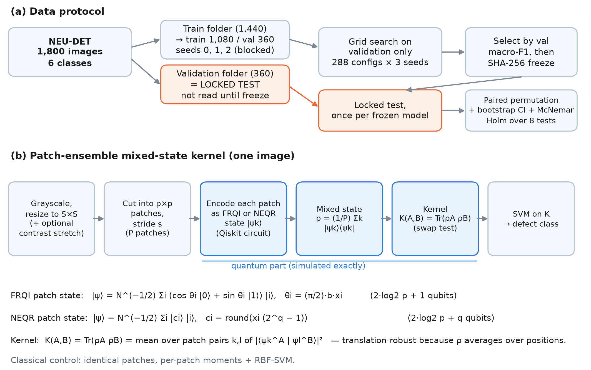

*Figure 1. Methodology. (a) Data protocol: validation-only model selection, SHA-256 freeze, one locked-test evaluation per frozen model and pre-declared statistics. (b) The patch-ensemble mixed-state kernel for one image.*

### 3.1 Dataset and splits

NEU-DET [3] contains 1,800 grayscale hot-rolled steel images of 6 defect classes (crazing, inclusion, patches, pitted surface, rolled-in scale, scratches; 300 per class). The 360 images of the official validation folder form the **locked test set**; they are not read until every model is frozen. The 1,440 train-folder images are split into 1,080 training and 360 validation images with a group-blocked strategy (group-blocked (blocks of 20 indices), 3 val blocks/class), for three split seeds (0, 1, 2). Table 1 gives the counts.

**Table 1. NEU-DET dataset and splits (per class; identical counts for seeds 0, 1, 2)**

| Class | Train | Validation | Locked test | Total |
|---|---|---|---|---|
| crazing | 180 | 60 | 60 | 300 |
| inclusion | 180 | 60 | 60 | 300 |
| patches | 180 | 60 | 60 | 300 |
| pitted surface | 180 | 60 | 60 | 300 |
| rolled-in scale | 180 | 60 | 60 | 300 |
| scratches | 180 | 60 | 60 | 300 |
| Total | 1080 | 360 | 360 | 1800 |

*Train/validation = group-blocked split of the 1,440 NEU-DET train-folder images (group-blocked (blocks of 20 indices), 3 val blocks/class); locked test = the 360 NEU-DET validation-folder images, read once per frozen model.*

### 3.2 Preprocessing and patch extraction

Each image is converted to grayscale, resized to S × S pixels (S ∈ {32, 64, 128}) and scaled to [0, 1]. Optionally, a per-image min–max contrast stretch is applied; it uses only the image itself, never training statistics. The image is cut into p × p patches with stride s, giving P = ((S − p)/s + 1)² patches.

### 3.3 Patch-ensemble mixed-state kernel

Each patch k is encoded as an FRQI state (2·log₂p + 1 qubits) or an NEQR state (2·log₂p + q qubits) with the same encoder circuits used for whole images. The image I is represented by the mixed state of a uniformly chosen patch:

```
ρ_I = (1/P) Σₖ |ψₖ⟩⟨ψₖ|
```

and two images are compared by the Hilbert–Schmidt overlap

```
K(A, B) = Tr(ρ_A ρ_B) = (1 / (P_A P_B)) Σₖ Σₗ |⟨ψₖᴬ | ψₗᴮ⟩|²
```

This is the average squared overlap over all pairs of patches, so a pattern that appears anywhere in both images contributes, regardless of its position. On hardware, a swap test between one random patch state of A and one of B estimates K(A, B) directly, because the swap test measures Tr(ρσ) for mixed inputs. An SVM with a precomputed kernel is trained on K. In this study all overlaps were computed exactly from statevectors on a CPU; unit tests confirm that the result equals the mean squared overlap of the Qiskit encoder statevectors and that the kernel is robust to translations of the image content. Figure 2 illustrates every step on a real training image.


*Figure 2. The method on a real NEU-DET training image (frozen FRQI settings: 64×64, 8×8 patches, stride 4). (a) image and example patches; (b) one patch; (c) its 7-qubit FRQI amplitudes; (d) the image's mixed state ρ; (e) normalised kernel between classes (10 training images per class).*

### 3.4 Classical control

To separate the effect of patching from that of the quantum encoding, a classical control uses the identical patches (same S, p, s and normalisation) and describes each image by classical patch-intensity moments, classified with an RBF-SVM. It has no circuit and is labelled classical throughout.

### 3.5 Hyper-parameter search, selection and freezing

Table 2 lists the grid: image size, patch size and stride, normalisation, the FRQI angle scale b or the NEQR bit depth q, and the SVM regularisation C. In total 288 configurations were trained for each of three split seeds (864 runs, 0 failed). Within each group the configuration with the highest mean validation macro-F1 was selected; the locked test set was not consulted. The FRQI and NEQR headline models were chosen by the same rule, declared before testing. Selections were written to disk, hashed with SHA-256 and frozen; the test stage aborts if any selection file changes. Each frozen group was then evaluated on the locked test set exactly once, and every access was logged. Table 3 lists the selected configurations.

**Table 2. Hyper-parameter grid searched on the validation split (test never used)**

| Group | Image size, patch p, stride s | Encoding option | Normalisation | SVM C | Configs | Runs (×3 seeds) |
|---|---|---|---|---|---|---|
| FRQI patches 4×4 | 32² p4 s2; 64² p4 s4 | angle ×1, 2, 4 | none, stretch | 1, 10, 100, 1000 | 48 | 144 |
| FRQI patches 8×8 | 32² p8 s4; 64² p8 s4; 128² p8 s8 | angle ×1, 2, 4 | none, stretch | 1, 10, 100, 1000 | 72 | 216 |
| NEQR patches 2×2 | 32² p2 s1; 64² p2 s2 | 4, 5, 6 bits | none, stretch | 1, 10, 100, 1000 | 48 | 144 |
| NEQR patches 4×4 | 32² p4 s2; 64² p4 s4; 128² p4 s4 | 3, 4 bits | none, stretch | 1, 10, 100, 1000 | 48 | 144 |
| Classical RBF-SVM, same patches | 64² p4 s4; 64² p8 s4; 128² p4 s4 | γ 0.3, 1, 3 | none, stretch | 1, 10, 100, 1000 | 72 | 216 |
| Total |  |  |  |  | 288 | 864 |

*Selection rule: maximum mean validation macro-F1 over seeds 0–2. Selections were SHA-256 frozen before the locked test was read.*

**Table 3. Configurations selected by validation macro-F1**

| Group | Image | Patch / stride | Patches per image | Encoding | Normalisation | C | Qubits per patch state | State dimension D |
|---|---|---|---|---|---|---|---|---|
| FRQI patches 4×4 | 64×64 | 4×4 / 4 | 256 | FRQI, angle ×4 | per-image stretch | 1000 | 5 | 32 |
| FRQI patches 8×8 | 64×64 | 8×8 / 4 | 225 | FRQI, angle ×4 | per-image stretch | 1000 | 7 | 128 |
| NEQR patches 2×2 | 64×64 | 2×2 / 2 | 1024 | NEQR, 4-bit | none | 1000 | 6 | 64 |
| NEQR patches 4×4 | 128×128 | 4×4 / 4 | 1024 | NEQR, 4-bit | none | 1000 | 8 | 256 |
| Classical RBF-SVM, same patches | 64×64 | 8×8 / 4 | 225 | patch moments, γ=1 | per-image stretch | 1000 | — (classical) | — |

*ρ is a D×D density matrix (average of the patch states). FRQI: 2·log2(p)+1 qubits; NEQR: 2·log2(p)+q qubits.*

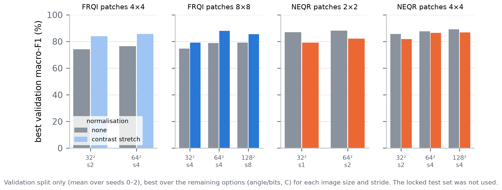

*Figure 3. Validation-only hyper-parameter sweep: best validation macro-F1 for each image size / stride and normalisation. The locked test set was not used.*

### 3.6 Statistical analysis

Eight comparisons were declared before testing (Table 5). For each, per-image correctness is averaged over the three seeds and compared with a paired sign-flip permutation test (10,000 permutations); 95 % confidence intervals come from a paired bootstrap, and an exact McNemar test [8] is reported per seed. p-values are corrected over the eight comparisons with the Holm method [7].

### 3.7 Reconstruction study

Independently of classification, every one of the 1,800 NEU-DET images was encoded and reconstructed with 20 methods: whole-image FRQI at 2×2 to 16×16, whole-image NEQR at the same sizes with 2, 4 and 8 bits, the V4 patch representations (FRQI 8×8 patches, NEQR 4×4 patches) and, for reference, classical PCA with 8 and 12 components (fit on the seed-0 training split). Quantum rows use the real Qiskit encoder circuits [9], Qiskit-Aer statevector simulation, and both the exact output distribution and multinomial samples of 100 to 100,000 shots, decoded with the project's decoder. Reconstruction uses no labels, so including test-folder images cannot influence model selection.

### 3.8 Implementation

Python, Qiskit / Qiskit-Aer [9] and scikit-learn [11]. Circuit resources are reported after transpilation to the basis {cx, rz, sx, x} at optimisation level 1 with all-to-all coupling. Everything ran on a CPU; no quantum hardware and no noise model were used. The selection was frozen at 2026-11-17T05:06:51 (SHA-256 b1735fdcfb035a69…). Table 10 lists the 17 automated integrity checks, all of which pass.

## 4. Results

### 4.1 Main result

Table 4 and Figure 4 summarise the locked-test results. The FRQI headline model (8×8 patches, 7 qubits per patch state) reaches **87.8 ± 1.5 %** accuracy (macro-F1 87.5 ± 1.6 %); the NEQR headline model (4×4 patches, 4-bit, 8 qubits) reaches **82.7 ± 10.1 %** (macro-F1 80.4 ± 13.5 %). For FRQI, validation macro-F1 (88.0 %) and test macro-F1 (87.5 %) are close; for NEQR the test score is lower and more variable (Section 4.4).

**Table 4. Main results on the locked test set (360 images; mean ± s.d. over seeds 0–2)**

| Model | Type | Validation macro-F1 % | Test accuracy % | Test macro-F1 % | Per-seed test accuracy % |
|---|---|---|---|---|---|
| FRQI patches 4×4 | quantum (simulated) | 85.7 | 85.3 ± 1.7 | 85.0 ± 1.6 | 86.9, 85.3, 83.6 |
| FRQI patches 8×8 | quantum (simulated) | 88.0 | 87.8 ± 1.5 | 87.5 ± 1.6 | 86.7, 87.2, 89.4 |
| NEQR patches 2×2 | quantum (simulated) | 88.2 | 81.5 ± 10.6 | 79.2 ± 14.1 | 85.6, 69.4, 89.4 |
| NEQR patches 4×4 | quantum (simulated) | 89.2 | 82.7 ± 10.1 | 80.4 ± 13.5 | 87.5, 71.1, 89.4 |
| Classical RBF-SVM, same patches | classical | 83.8 | 83.6 ± 0.3 | 83.3 ± 0.3 | 83.3, 83.9, 83.6 |
| V2 FRQI, whole image (baseline) | reference | 69.3 | 60.6 ± 1.2 | 58.3 ± 1.3 | — |
| V2 NEQR, whole image (baseline) | reference | 72.7 | 60.2 ± 0.4 | 56.5 ± 0.4 | — |
| V3 classical texture RBF-SVM (best classical) | reference | 95.3 | 95.6 ± 2.2 | 95.5 ± 2.2 | — |

*Headline models (pre-declared rule, by validation): FRQI = FRQI patches 8×8, NEQR = NEQR patches 4×4. Exact noiseless CPU simulation (no quantum hardware).*

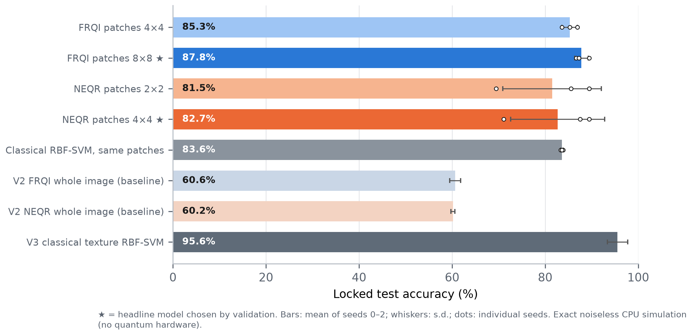

*Figure 4. Locked-test accuracy of all V4 groups and reference models (mean ± s.d. over seeds 0–2; dots = individual seeds; ★ = headline chosen by validation).*

### 4.2 Improvement over whole-image FRQI and NEQR

The patch-ensemble kernel improves FRQI by **+27.1 pp** over the V2 whole-image FRQI kernel (95 % CI [+21.7, +32.7], p_Holm < 0.001) and by +30.3 pp over the best V3 FRQI kernel ([+25.1, +35.4], p_Holm < 0.001). NEQR improves by **+22.5 pp** ([+18.5, +26.7], p_Holm < 0.001). FRQI is now better than NEQR by +5.1 pp ([+1.1, +9.0], p_Holm = 0.045). Figure 5 shows the progression across protocols and Figure 6 all eight comparisons.

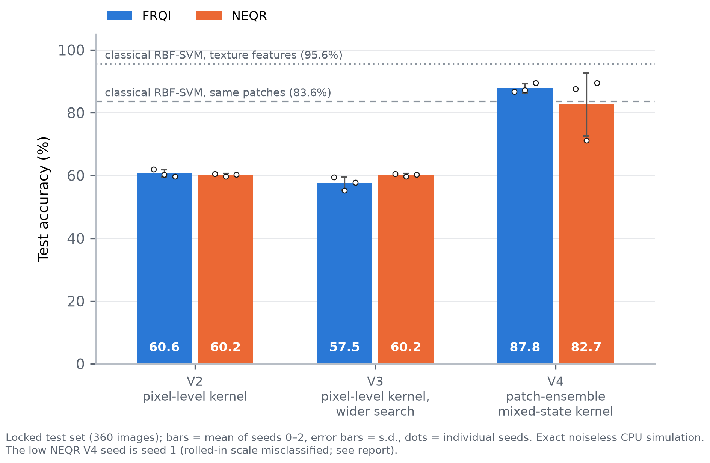

*Figure 5. FRQI and NEQR test accuracy across protocols V2, V3 and V4, with classical references.*

**Table 5. The 8 pre-declared paired comparisons (Holm-corrected)**

| Comparison (a vs b) | Acc. a % | Acc. b % | Δ pp | 95% CI pp | p (Holm) | Significant | McNemar a-only:b-only (seeds 0/1/2) |
|---|---|---|---|---|---|---|---|
| V4 FRQI vs V2 FRQI (E1b-frqi8-qkc-scaled) | 87.8 | 60.6 | +27.1 | [+21.7, +32.7] | <0.001 | yes | 114:25 / 118:21 / 123:16 |
| V4 FRQI vs V3 FRQI (V3-frqi8) | 87.8 | 57.5 | +30.3 | [+25.1, +35.4] | <0.001 | yes | 120:22 / 134:19 / 131:17 |
| V4 NEQR vs V2 NEQR (E2-neqr16-b4-qkc) | 82.7 | 60.2 | +22.5 | [+18.5, +26.7] | <0.001 | yes | 108:11 / 48:7 / 119:14 |
| V4 FRQI vs V4 NEQR | 87.8 | 82.7 | +5.1 | [+1.1, +9.0] | 0.045 | yes | 30:33 / 87:29 / 32:32 |
| V4 FRQI vs classical patch-moment RBF-SVM | 87.8 | 83.6 | +4.2 | [+0.5, +7.7] | 0.060 | no | 36:24 / 34:22 / 42:21 |
| V4 NEQR vs classical patch-moment RBF-SVM | 82.7 | 83.6 | -0.9 | [-4.9, +3.1] | 0.678 | no | 40:25 / 34:80 / 44:23 |
| V4 FRQI vs classical texture RBF-SVM (V3-tex12c-rbfsvm) | 87.8 | 95.6 | -7.8 | [-10.9, -4.7] | <0.001 | yes | 12:40 / 11:36 / 6:37 |
| V4 NEQR vs classical texture RBF-SVM (V3-tex12c-rbfsvm) | 82.7 | 95.6 | -12.9 | [-15.8, -10.0] | <0.001 | yes | 7:32 / 3:86 / 5:36 |

*Paired sign-flip permutation test (10,000) on per-image correctness averaged over seeds; bootstrap 95% CI; Holm correction over 8 tests.*

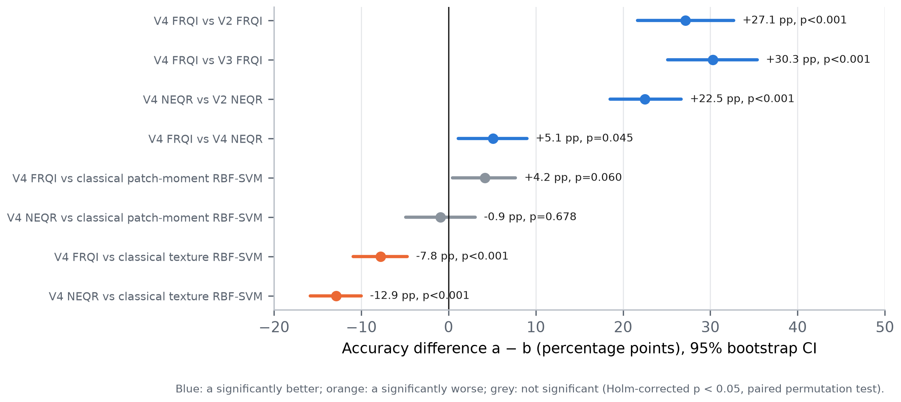

*Figure 6. The eight pre-declared paired comparisons: accuracy difference with 95 % bootstrap CI and Holm-corrected p-values.*

### 4.3 Comparison with classical models

On identical patches, the classical RBF-SVM control reaches 83.6 ± 0.3 %. The FRQI kernel is +4.2 pp higher, but the difference is not significant after Holm correction (CI [+0.5, +7.7], p_Holm = 0.060); NEQR differs by -0.9 pp (p_Holm = 0.678). Most of the gain over the whole-image kernels therefore comes from the patch representation, which classical models can use equally well. The best classical texture model of Protocol V3 (RBF-SVM on texture features, 95.6 ± 2.2 %) remains clearly better than both FRQI (-7.8 pp, p_Holm < 0.001) and NEQR (-12.9 pp, p_Holm < 0.001).

### 4.4 Per-class behaviour and stability

Figure 7, Figure 8 and Table 6 show per-class results. Summed over three seeds, FRQI classifies 178 of 180 rolled-in-scale test images correctly, NEQR only 118. NEQR's seed accuracies are 87.5, 71.1, 89.4 %; on seed 1 it misclassifies every rolled-in-scale image (Figure 9). The earlier whole-image kernels also failed on this class, which suggests a brightness difference between the train and test folders for it; FRQI, selected with per-image contrast stretch, is not affected. NEQR was selected without stretch and was not re-tuned after the test, since that would use the test set for model choice.

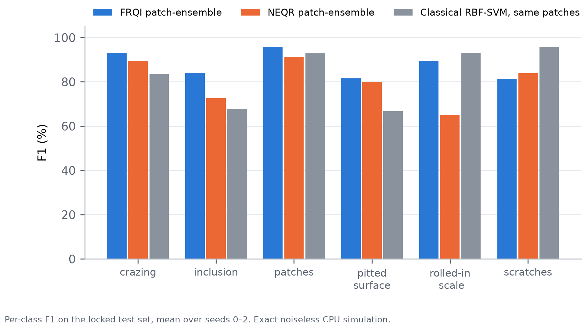

*Figure 7. Per-class F1 on the locked test set (mean over seeds).*

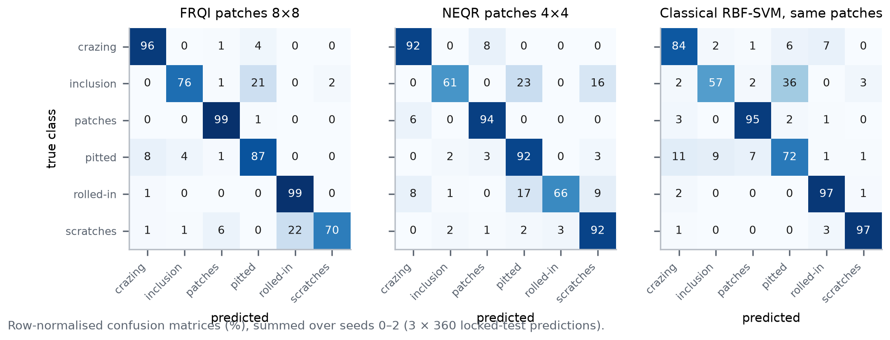

*Figure 8. Row-normalised confusion matrices summed over seeds 0–2.*

**Table 6. Per-class F1 % on the locked test set (mean over seeds 0–2)**

| Model | crazing | inclusion | patches | pitted surface | rolled-in scale | scratches |
|---|---|---|---|---|---|---|
| FRQI patches 4×4 | 85.8 | 85.5 | 94.8 | 74.7 | 89.8 | 79.6 |
| FRQI patches 8×8 | 93.1 | 84.0 | 95.8 | 81.5 | 89.5 | 81.3 |
| NEQR patches 2×2 | 88.6 | 72.7 | 91.6 | 82.8 | 62.1 | 77.3 |
| NEQR patches 4×4 | 89.5 | 72.7 | 91.4 | 80.0 | 65.0 | 84.0 |
| Classical RBF-SVM, same patches | 83.5 | 67.8 | 92.9 | 66.7 | 93.0 | 95.9 |

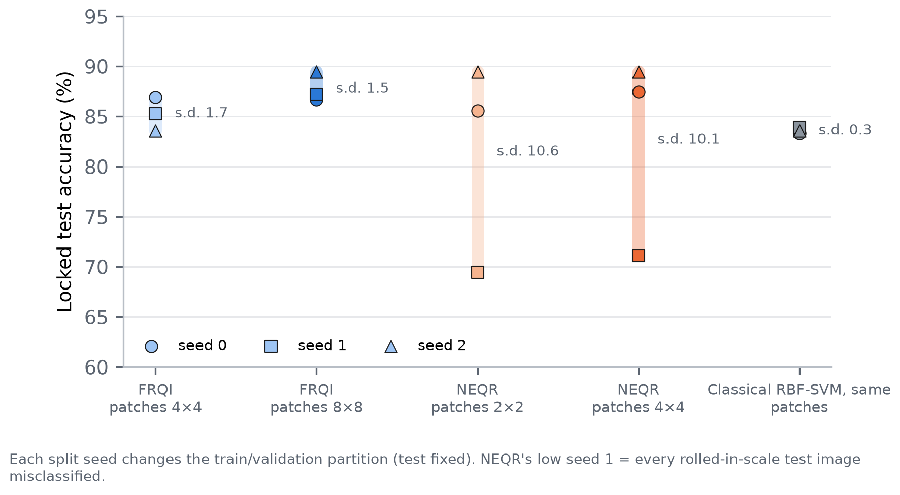

*Figure 9. Test accuracy of each split seed. NEQR's seed-1 drop is caused by the rolled-in-scale class.*

### 4.5 Circuit resources

Table 7 and Figure 10 report the encoder circuit for one patch state. The FRQI headline needs 7 qubits, 8,339 compiled gates (depth 4,878, 3,584 CX). A swap test between two patch states needs 2·7 + 1 = 15 qubits. Because the whole image is never loaded at once, qubit count depends on the patch size, not on the image size.

**Table 7. Encoder circuit resources for ONE patch state (Qiskit, transpiled)**

| Group | Qubits | Logical gates | Logical depth | Compiled gates | Compiled depth | CX (compiled) | Patches per image |
|---|---|---|---|---|---|---|---|
| FRQI patches 4×4 | 5 | 1093 | 705 | 1070 | 710 | 384 | 256 |
| FRQI patches 8×8 | 7 | 8583 | 4875 | 8339 | 4878 | 3584 | 225 |
| NEQR patches 2×2 | 6 | 20 | 15 | 150 | 99 | 55 | 1024 |
| NEQR patches 4×4 | 8 | 106 | 65 | 1998 | 1634 | 694 | 1024 |

*Basis {cx, rz, sx, x}, optimisation level 1, all-to-all coupling. A swap test between two patch states uses 2·qubits + 1 qubits.*

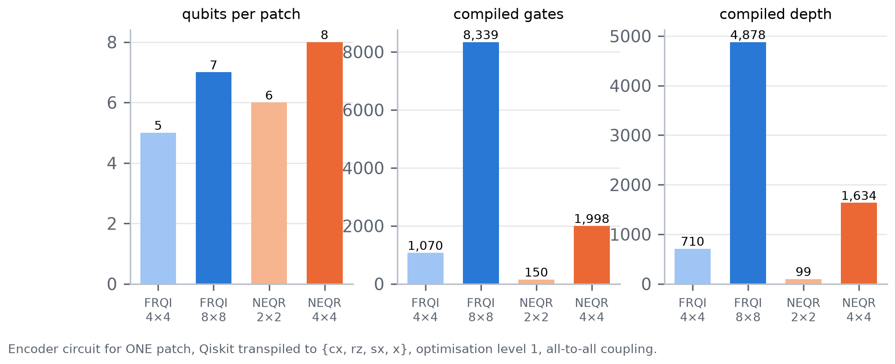

*Figure 10. Qubits, compiled gates and compiled depth of the encoder circuit for one patch.*

### 4.6 Reconstruction of all images

Table 8 and Figures 11–13 summarise the reconstruction of all 1,800 images. FRQI statevector decoding reproduced every image exactly at every resolution; its error comes only from finite shots and grows with image size because the shots are spread over more pixels (1,000 shots: MSE 8.66e-03 at 8×8 and 6.40e-02 at 16×16; 100,000 shots: 2.64e-04 at 16×16). NEQR is exact up to quantisation (4-bit floor MSE 3.68e-04; 8-bit lossless) once every pixel has been observed. The V4 FRQI patch representation reaches MSE 8.67e-03 with 1,000 shots per patch on 64×64 images. Classical PCA with 8 components keeps little of the image (SSIM 0.590; 12 components 0.603), which helps explain why PCA-input quantum classifiers in earlier protocols had little texture to work with.

**Table 8. Reconstruction of all 1,800 NEU-DET images by every method (mean MSE / SSIM)**

| Method | Encoding | Qubits | MSE exact (statevector) | MSE 1,000 shots | MSE most shots | SSIM 1,000 shots | Images exact (of 1,800) |
|---|---|---|---|---|---|---|---|
| R-FRQI-2x2 | FRQI | 3 | 0 (exact) | 4.24e-04 | 4.09e-06 (100,000) | 0.897 | 1,800 |
| R-FRQI-4x4 | FRQI | 5 | 0 (exact) | 1.73e-03 | 1.64e-05 (100,000) | 0.775 | 1,800 |
| R-FRQI-8x8 | FRQI | 7 | 0 (exact) | 8.66e-03 | 6.57e-05 (100,000) | 0.518 | 1,800 |
| R-FRQI-16x16 | FRQI | 9 | 0 (exact) | 6.40e-02 | 2.64e-04 (100,000) | 0.156 | 1,800 |
| R-NEQR-2x2-b2 | NEQR | 4 | 9.01e-03 | 9.01e-03 | 9.01e-03 (100,000) | 0.554 | 0 |
| R-NEQR-2x2-b4 | NEQR | 6 | 3.68e-04 | 3.68e-04 | 3.68e-04 (100,000) | 0.907 | 0 |
| R-NEQR-2x2-b8 | NEQR | 10 | 0 (exact) | 0 (exact) | 0 (exact) (100,000) | 1.000 | 1,800 |
| R-NEQR-4x4-b2 | NEQR | 6 | 8.97e-03 | 8.97e-03 | 8.97e-03 (100,000) | 0.542 | 0 |
| R-NEQR-4x4-b4 | NEQR | 8 | 3.68e-04 | 3.68e-04 | 3.68e-04 (100,000) | 0.934 | 0 |
| R-NEQR-4x4-b8 | NEQR | 12 | 0 (exact) | 0 (exact) | 0 (exact) (100,000) | 1.000 | 1,800 |
| R-NEQR-8x8-b2 | NEQR | 8 | 8.94e-03 | 8.94e-03 | 8.94e-03 (100,000) | 0.549 | 0 |
| R-NEQR-8x8-b4 | NEQR | 10 | 3.69e-04 | 3.69e-04 | 3.69e-04 (100,000) | 0.941 | 0 |
| R-NEQR-8x8-b8 | NEQR | 14 | 0 (exact) | 0 (exact) | 0 (exact) (100,000) | 1.000 | 1,800 |
| R-NEQR-16x16-b2 | NEQR | 10 | 8.93e-03 | 1.48e-02 | 8.93e-03 (100,000) | 0.385 | 0 |
| R-NEQR-16x16-b4 | NEQR | 12 | 3.68e-04 | 6.12e-03 | 3.68e-04 (100,000) | 0.630 | 0 |
| R-NEQR-16x16-b8 | NEQR | 16 | 0 (exact) | 5.75e-03 | 0 (exact) (100,000) | 0.673 | 1,800 |
| P-FRQI-64-p8 | FRQI | 7 | 0 (exact) | 8.67e-03 | 6.70e-04 (10,000) | 0.323 | 1,800 |
| P-NEQR-64-p4-b4 | NEQR | 8 | 3.67e-04 | 3.67e-04 | 3.67e-04 (10,000) | 0.888 | 0 |
| C-PCA8-64 | classical PCA | — | 4.66e-03 | — | — | 0.590 | — |
| C-PCA12-64 | classical PCA | — | 3.85e-03 | — | — | 0.603 | — |

*R- = whole image r×r; NEQR -bN = N-bit intensity; P- = V4 patch representation (shots per patch); C- = classical PCA (fit on seed-0 train). Real Qiskit circuits + Aer statevector + multinomial shots.*

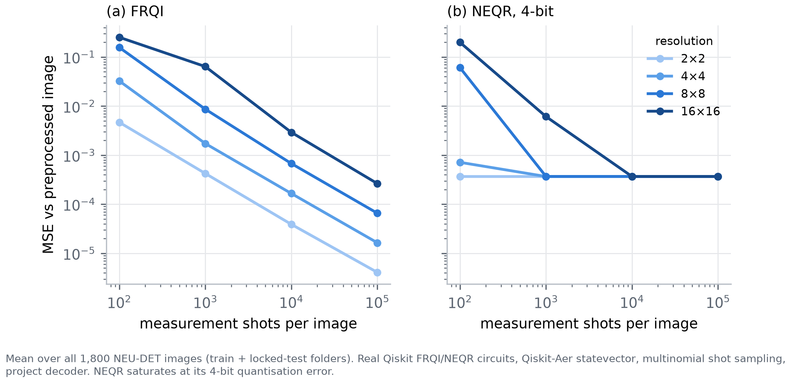

*Figure 11. Reconstruction MSE versus measurement shots, mean over all 1,800 images.*

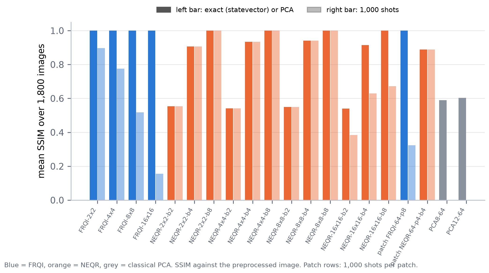

*Figure 12. Mean SSIM of every reconstruction method (exact and 1,000 shots).*

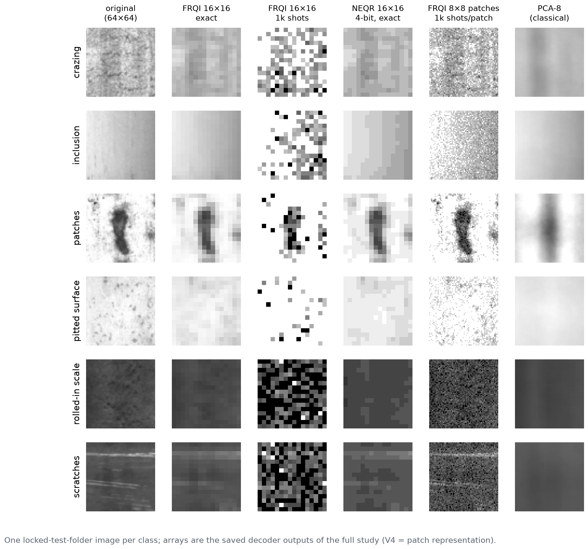

*Figure 13. One locked-test-folder image per class reconstructed by representative methods (saved decoder outputs).*

### 4.7 Per-image analysis across all protocols

Using the saved predictions of all 163 selected models of protocols V2–V4 (three seeds each), the median test image is classified correctly by 67 % of model-seed pairs; 0 images are never classified correctly and 0 are always classified correctly (Figure 14). Averaged over all models, rolled-in scale is the hardest class and patches the easiest. Table 9 and Figure 15 place the V4 models among the key models of all protocols.

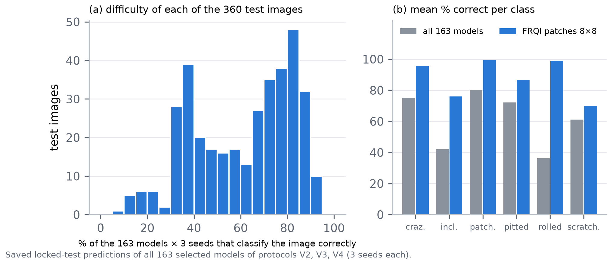

*Figure 14. (a) Fraction of all model-seed pairs that classify each test image correctly; (b) mean per class, all models vs V4 FRQI.*

**Table 9. Key models across protocols V2 → V3 → V4 (locked test accuracy %)**

| Protocol | Model | Type | Test accuracy % |
|---|---|---|---|
| V2 | FRQI, whole image (pixel kernel) | quantum | 60.6 ± 1.2 |
| V2 | NEQR, whole image (pixel kernel) | quantum | 60.2 ± 0.4 |
| V2 | ZZ-feature-map kernel on pixel PCA-8 | quantum | 64.0 ± 3.5 |
| V2 | Variational classifier (VQC) on pixel PCA-8 | quantum | 48.1 ± 1.9 |
| V2 | Classical RBF-SVM on pixel PCA-8 | classical | 64.8 ± 3.3 |
| V3 | ZZ-feature-map kernel on texture PCA-8 | quantum | 93.0 ± 3.0 |
| V3 | VQC on texture PCA-8 | quantum | 73.4 ± 3.8 |
| V3 | Classical RBF-SVM on texture PCA-12 | classical | 95.6 ± 2.2 |
| V4 | FRQI patch-ensemble kernel (8×8) | quantum | 87.8 ± 1.5 |
| V4 | NEQR patch-ensemble kernel (4×4) | quantum | 82.7 ± 10.1 |
| V4 | Classical RBF-SVM on the same patches | classical | 83.6 ± 0.3 |

*Same dataset, splits, seeds and locked test set in every protocol. Quantum = exact CPU simulation.*

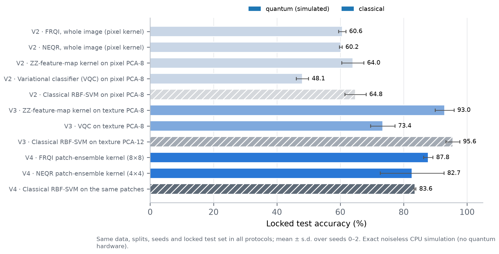

*Figure 15. Key quantum (simulated) and classical models across protocols V2, V3 and V4.*

## 5. Discussion

The central result is that the poor accuracy of FRQI and NEQR kernels on NEU-DET was caused by *what* was compared, not by the encodings themselves. Averaging encoded patches into a mixed state turns a position-sensitive similarity into a texture-sensitive one, and both encodings gain more than 20 percentage points. FRQI benefits more than NEQR (+5.1 pp). A plausible explanation is that its continuous angles combined with the contrast stretch give a smooth similarity, while NEQR's discrete intensity levels make its overlaps all-or-nothing per pixel and more sensitive to brightness shifts.

The matched control shows that the improvement should not be read as a quantum effect. A classical model on the same patches is statistically indistinguishable from the FRQI kernel, and a classical texture model is better still. Every kernel in this study has a closed form and was computed classically, so the study demonstrates a better *use* of quantum image representations, not a computational advantage.

The method is nevertheless hardware-friendly in one respect: the circuit size is set by the patch (5–8 qubits per patch state here), not by the image, and the kernel needs only swap tests between random patch pairs. The cost moves into the number of shots, which we did not simulate for classification.

## 6. Limitations and threats to validity

- **Simulation only.** No quantum hardware and no noise model were used. Kernel entries were exact; a hardware estimate would require many swap-test shots per entry.
- **No quantum advantage.** All overlaps are classically computable, and a classical model on identical patches performs equally well.
- **The locked test set is not fresh.** It was used by protocols V2 and V3; V4 was proposed after their weak FRQI/NEQR results. V4 was frozen on validation and tested once, but the protocol-level choice of method was informed by earlier test results.
- **Validation-only exploration.** Before the grid was fixed, a few patch geometries were explored on the validation split (never the test set); all but one are part of the reported grid.
- **NEQR instability.** NEQR's accuracy varies strongly across splits (s.d. 10.1 pp), driven by one class.
- **One dataset.** Results are for NEU-DET only.

## 7. Conclusion

Representing an image by the mixed state of its encoded patches and comparing images by Tr(ρAρB) raises FRQI kernel accuracy on NEU-DET from 60.6 ± 1.2 % to 87.8 ± 1.5 % and NEQR from 60.2 ± 0.4 % to 82.7 ± 10.1 % under a leakage-controlled, pre-registered evaluation. The gain is real and statistically significant against the whole-image kernels, but it is matched by a classical model on the same patches and does not reach the best classical texture model (95.6 ± 2.2 %). Future work should estimate the kernel with finite swap-test shots and realistic noise, test on a fresh dataset, and study whether patch-ensemble kernels on larger patches retain their accuracy when they are no longer classically simulable.

## Data and code availability

All numbers, tables and figures are generated from the saved result files by `research_paper_visuals/source/make_v4_paper_pack.py` and this text by `write_v4_paper.py`. Protocol V4 is reproduced by `scripts/v4/` (setup → candidates → select → freeze → test → analyse → verify). An interactive dashboard page (“How it works”) replays the full pipeline on any test image and recomputes the frozen model's prediction live.

## References

[1] P. Q. Le, F. Dong, K. Hirota, “A flexible representation of quantum images for polynomial preparation, image compression, and processing operations,” Quantum Information Processing, 10(1):63–84, 2011.
[2] Y. Zhang, K. Lu, Y. Gao, M. Wang, “NEQR: a novel enhanced quantum representation of digital images,” Quantum Information Processing, 12(8):2833–2860, 2013.
[3] K. Song, Y. Yan, “A noise robust method based on completed local binary patterns for hot-rolled steel strip surface defects,” Applied Surface Science, 285:858–864, 2013.
[4] V. Havlíček, A. D. Córcoles, K. Temme, A. W. Harrow, A. Kandala, J. M. Chow, J. M. Gambetta, “Supervised learning with quantum-enhanced feature spaces,” Nature, 567:209–212, 2019.
[5] M. Schuld, N. Killoran, “Quantum machine learning in feature Hilbert spaces,” Physical Review Letters, 122:040504, 2019.
[6] H. Buhrman, R. Cleve, J. Watrous, R. de Wolf, “Quantum fingerprinting,” Physical Review Letters, 87:167902, 2001.
[7] S. Holm, “A simple sequentially rejective multiple test procedure,” Scandinavian Journal of Statistics, 6(2):65–70, 1979.
[8] Q. McNemar, “Note on the sampling error of the difference between correlated proportions or percentages,” Psychometrika, 12(2):153–157, 1947.
[9] A. Javadi-Abhari et al., “Quantum computing with Qiskit,” arXiv:2405.08810, 2024.
[10] C. Cortes, V. Vapnik, “Support-vector networks,” Machine Learning, 20:273–297, 1995.
[11] F. Pedregosa et al., “Scikit-learn: Machine learning in Python,” Journal of Machine Learning Research, 12:2825–2830, 2011.

*Check every reference against the original publication and your journal's citation style before submission.*
